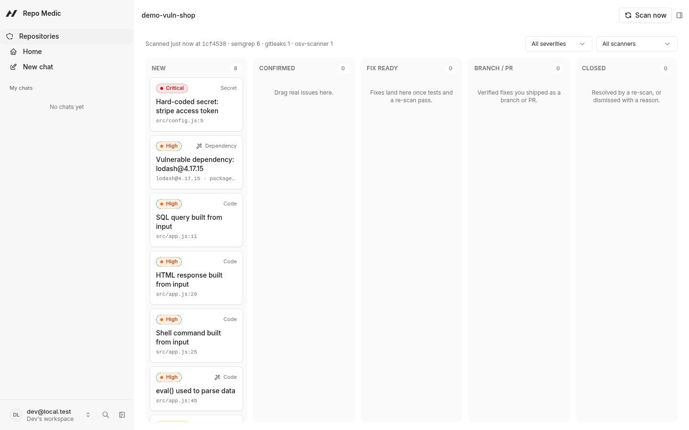
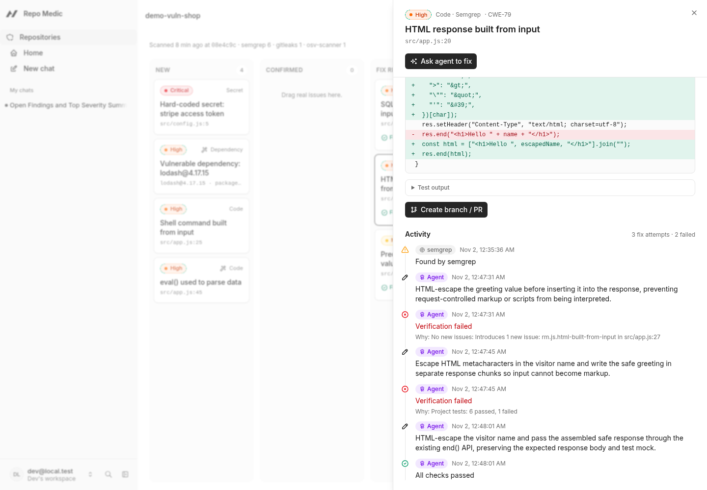
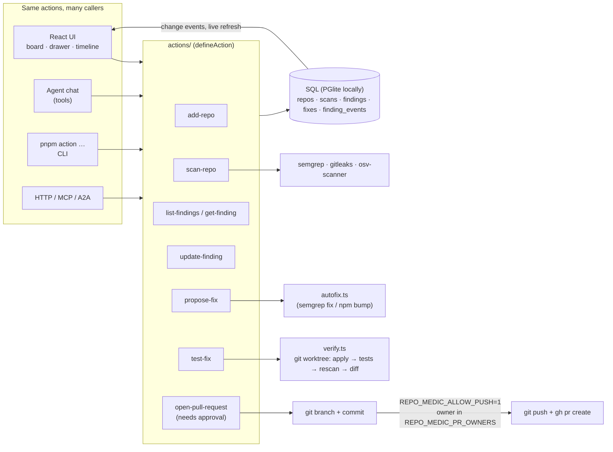
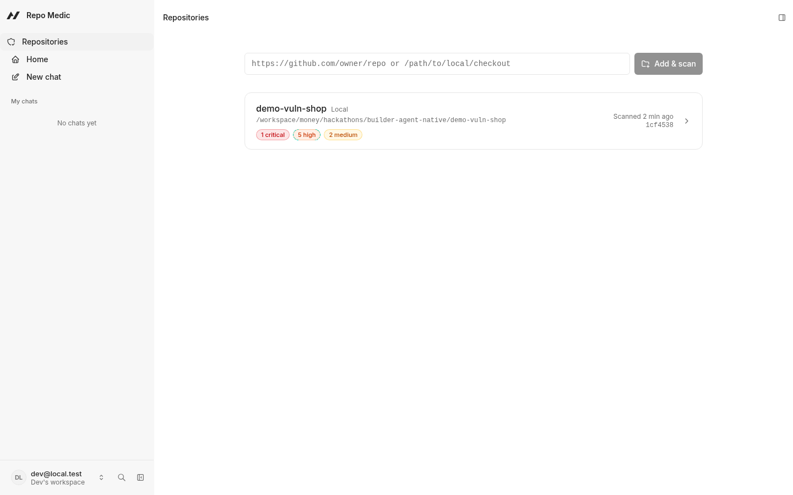
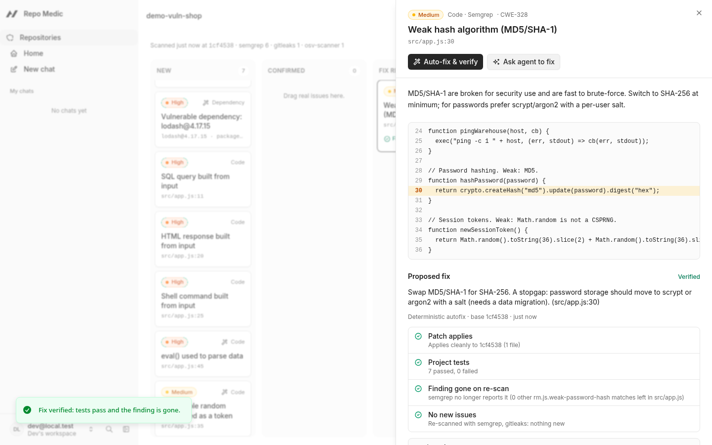
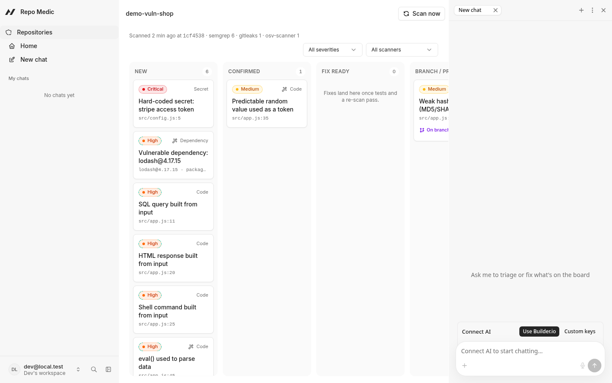
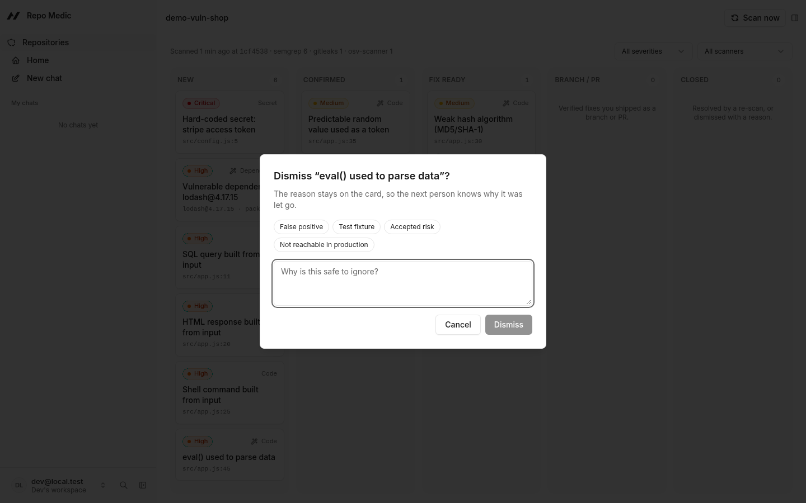
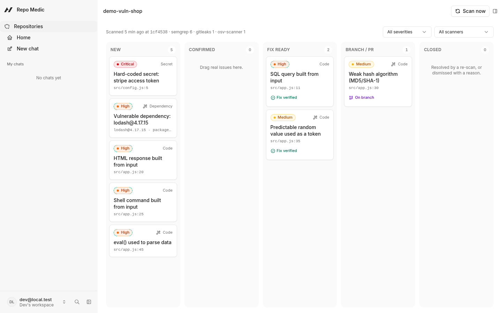

# Repo Medic

**A security triage board where you and an AI agent fix vulnerabilities together, and every fix has to prove it works.**

Point Repo Medic at a repository. It runs real scanners, puts every finding on a board, and turns the findings that matter into patches that are *verified*: the patch applies, the project's tests pass, the scanner no longer reports the issue, and nothing new appears. Only then can a human approve it into a branch and a GitHub pull request. You and the agent work the same board through the same actions, and the drawer shows who did what, including every failed attempt and why it failed.

Built with [Agent-Native](https://agent-native.com) (`@agent-native/core` 0.222.2, chat template) for the [Builder.io Agent-Native Hackathon](https://www.builder.io/hackathon).

- App: https://github.com/halfabillion/repo-medic
- Demo target (deliberately vulnerable, never deploy): https://github.com/halfabillion/repo-medic-demo-shop
- A real PR opened by Repo Medic: https://github.com/halfabillion/repo-medic-demo-shop/pull/1



## The problem

Security scanners are cheap to run and expensive to act on. A scan of a small app produces a pile of findings: some real, some noise, some needing a dependency bump, some needing a code change. Someone then has to triage each one, write a fix, check that it does not break the app, check that it actually removed the issue, and open a PR. AI can write the patch, but an unverified AI patch is just another thing to review.

Repo Medic keeps people in charge of the decisions (what matters, what gets dismissed, what gets merged) and gives the agent the busywork (reading code, writing diffs, retrying when a check fails), with hard verification in between.

## How it works

1. **Scan.** `scan-repo` runs three free, open-source scanners in parallel and normalises their output:
   - [Semgrep](https://semgrep.dev) with a small rule pack (`scanners/semgrep/`) for SQL injection, XSS, command injection, `eval`, weak hashes and predictable tokens;
   - [gitleaks](https://github.com/gitleaks/gitleaks) for hard-coded secrets (redacted before they are stored);
   - [osv-scanner](https://github.com/google/osv-scanner) for vulnerable dependencies, rolled up to one card per package with the smallest version that fixes every advisory.
   Findings are fingerprinted, so a re-scan updates cards instead of duplicating them, closes what is gone, and reopens what came back.
2. **Triage.** Drag cards between *New*, *Confirmed* and *Closed*. Dismissing always asks for a reason, which stays on the card.
3. **Fix.** Three ways in, one way out:
   - **Auto-fix & verify:** deterministic rewrites from the Semgrep rules, or a dependency bump that skips deprecated releases;
   - **Ask agent to fix:** hands the card to the agent, which reads the code, writes a diff, verifies it, and retries (up to 3 times) when a check fails;
   - **Your own diff** via `propose-fix`.
4. **Verify.** `test-fix` checks the patch in a throwaway git worktree: *patch applies → tests pass → finding gone on re-scan → no new issues*. Only a fully green fix moves the card to **Fix ready**. Neither you nor the agent can drag a card into *Fix ready* or *Branch / PR*; those columns are earned.
5. **Ship.** `open-pull-request` needs explicit human approval. It commits the verified patch to a `repo-medic/…` branch, and when pushing is enabled for that GitHub owner, pushes it and opens a PR whose body contains the verification table.
6. **Audit.** Every step is logged to an activity timeline in the finding drawer: who (Agent, a person, or the scanner), when, what, and for failures, *why* (for example "No new issues: introduces 1 new issue rm.js.html-built-from-input in src/app.js:27").



## Architecture



## Agent-Native: one action layer for the UI and the agent

Every capability is a single `defineAction()` in `actions/`. The **Auto-fix & verify** button, the agent's tool call, `pnpm action test-fix` in a terminal, and an MCP client all run the same code with the same validation and the same rules. Concretely:

| | |
| --- | --- |
| **Same actions** | UI buttons call actions through the framework's React hooks; the agent gets the same actions as tools; the CLI, HTTP and MCP surfaces come for free. There is no "agent API" separate from the "UI API". |
| **Shared screen state** | The board publishes `view`, `repoId` and the open `findingId`; `view-screen` adds column counts and the open card, so "fix this one" just works. `navigate` lets the agent open a card for you. |
| **Live, shared data** | Writes emit change events, so when the agent's fix passes, the card moves to *Fix ready* on your screen without a reload. |
| **Receipts and next steps** | Writes return a `_receipt` (what changed, what was verified) and a `nextRequiredAction`, so the agent always knows the next step (propose → test → ask for approval). |
| **Who did it** | Each action sees its caller (`ctx.caller`: tool, frontend, cli, mcp, …). Repo Medic records it, so the timeline can say *Agent*, *you*, or *you (CLI)*. |

## Safety model

Guard rails live in the actions, not in the prompt, so they apply to every caller, including the agent:

- **Earned statuses.** *Fix ready* requires a passing `test-fix`; *Branch / PR* requires `open-pull-request`. Nobody can drag a card there.
- **Human approval for anything that leaves the box.** `open-pull-request` is marked `needsApproval`; the agent must ask, and a person clicks **Approve & create**.
- **Push is off by default.** Pushing and opening PRs needs `REPO_MEDIC_ALLOW_PUSH=1` *and* the repo's GitHub owner in `REPO_MEDIC_PR_OWNERS`. Without them, Repo Medic only creates a local branch.
- **No stale patches.** A PR is refused (`stale_base`) if the fix was verified against a commit that is no longer in the branch's history; re-scan and re-verify first. A re-scan also sends such *Fix ready* cards back to *Confirmed*, with a timeline entry saying why.
- **Verification in isolation.** Patches are applied and tested in a throwaway `git worktree`, never in your working copy. Diffs are size-limited (200 KB) and applied with `git apply`, which refuses paths outside the repository.
- **Untrusted code doesn't run by default.** Repos cloned from GitHub don't get their tests executed unless `REPO_MEDIC_RUN_UNTRUSTED_TESTS=1`. Local repos must sit under `REPO_MEDIC_LOCAL_ROOTS`.
- **Secrets are redacted** before they are stored, and leaked secrets are never "auto-fixed": the card says to rotate the key.
- **Credentials.** Repo Medic stores no GitHub token. Pushing uses your existing `git`/`gh` login on the machine running the server.

## Set up

Prerequisites: Node 22+, pnpm (via corepack), git, and the scanners on `PATH`: `semgrep`, `gitleaks`, `osv-scanner`. For PRs: the [GitHub CLI](https://cli.github.com) logged in (`gh auth login`).

```bash
git clone https://github.com/halfabillion/repo-medic.git
git clone https://github.com/halfabillion/repo-medic-demo-shop.git   # deliberately vulnerable demo target
cd repo-medic
pnpm install
cp .env.example .env   # optional switches, see below
pnpm dev               # http://localhost:8080 → "Continue as local dev"
```

On the Repositories page, add the demo checkout (`../repo-medic-demo-shop`) and press **Scan**. Or from the CLI:

```bash
export AGENT_USER_EMAIL=dev@local.test     # the local-dev UI user
export AGENT_ORG_ID=<org id>               # that user's workspace, so the CLI sees the same board
pnpm action add-repo --source "$(realpath ../repo-medic-demo-shop)"
pnpm action scan-repo --repoId <repo id>
pnpm action propose-fix --findingId <finding id>     # built-in autofix, or pass --diff
pnpm action test-fix --id <fix id>
pnpm action open-pull-request --id <fix id>          # asks for approval
```

The chat agent needs a model: click **Connect AI** in the agent panel and choose *Use Builder.io* or *Custom keys*. Everything except the chat works without one.

### Configuration

| Variable | Default | Meaning |
| --- | --- | --- |
| `REPO_MEDIC_LOCAL_ROOTS` | parent of the app | Colon-separated directories local repos may live in. |
| `REPO_MEDIC_RUN_UNTRUSTED_TESTS` | off | Run `npm test` for repos cloned from GitHub (local repos always run tests). |
| `REPO_MEDIC_ALLOW_PUSH` | off | `1` lets `open-pull-request` push the branch and run `gh pr create`. |
| `REPO_MEDIC_PR_OWNERS` | empty | Comma-separated GitHub owners PRs may be opened against. |

The server reads these at start-up, so restart `pnpm dev` after changing them.

## Screenshots

| | |
| --- | --- |
|  |  |
| Repositories and last scan | A verified auto-fix: all four checks green |
|  |  |
| Handing a card to the agent | The activity timeline, with failed attempts and reasons |
|  |  |
| Dismissing requires a reason | The board after fixes |

## Development

```bash
pnpm test                 # vitest: scanner parsers (real fixtures), status rules, autofix, git/path safety, PR text
pnpm typecheck
pnpm agent-native:doctor  # framework guards
```

Code map: `server/lib/scanners/` (run + normalise), `server/lib/autofix.ts`, `server/lib/verify.ts`, `server/lib/git.ts` (worktrees), `server/lib/status.ts` (triage rules), `server/lib/events.ts` (activity log), `app/components/repos/` (board, card, drawer, timeline).

## Limits (honest list)

- Autofix and test runs support JavaScript/TypeScript + npm only; the scanners themselves cover more.
- Tests run on the host in a worktree, not in a container sandbox, which is why cloned repos don't run tests unless you opt in.
- Transitive dependency findings get advice (use `overrides`) rather than an automatic bump.
- The weak-hash autofix swaps MD5/SHA-1 for SHA-256 as a stopgap; real password storage needs a salted KDF (scrypt/argon2) and a data migration, and the fix summary says so.
- Leaked secrets are never auto-fixed: the key must be rotated by a person.

## Built during the hackathon

The hackathon started on 27 Oct 2026. All Repo Medic code was written from 2 Nov 2026 onwards, during the event. See [`BUILD_LOG.md`](BUILD_LOG.md) for a file-by-file list.

- **Pre-existing, not my work:** the Agent-Native framework and its chat template (`npx @agent-native/core create --template chat`, first commit in this repo), the open-source scanners (Semgrep, gitleaks, osv-scanner, used as external binaries), and npm dependencies.
- **Built during the event:** the data model, scanner runners and normaliser, Semgrep rule pack with autofixes, the verification pipeline, triage rules, all Repo Medic actions, the board/drawer/timeline UI, agent instructions, tests, the GitHub PR flow, and the demo repository.
- **AI assistance:** much of the code and docs were written with an AI coding assistant (Grok Bot) under my direction.

## Licence

MIT, see [LICENSE](LICENSE). The Agent-Native framework and template files are © their authors under their own licence.
